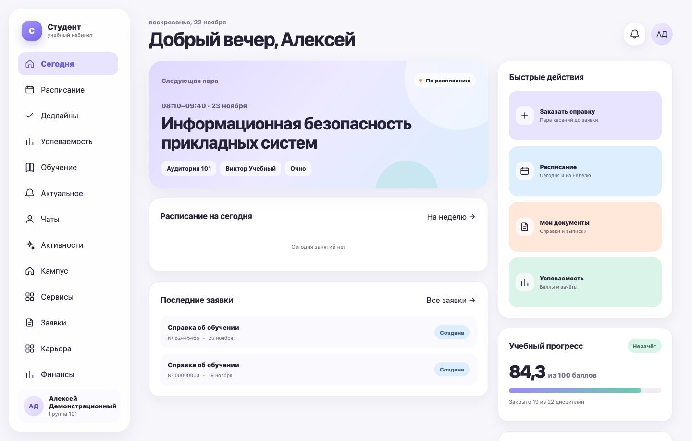
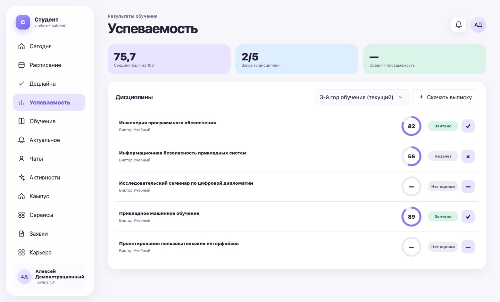
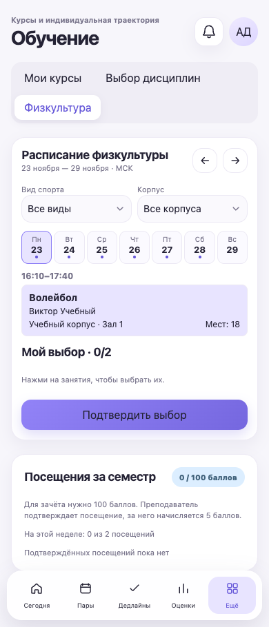
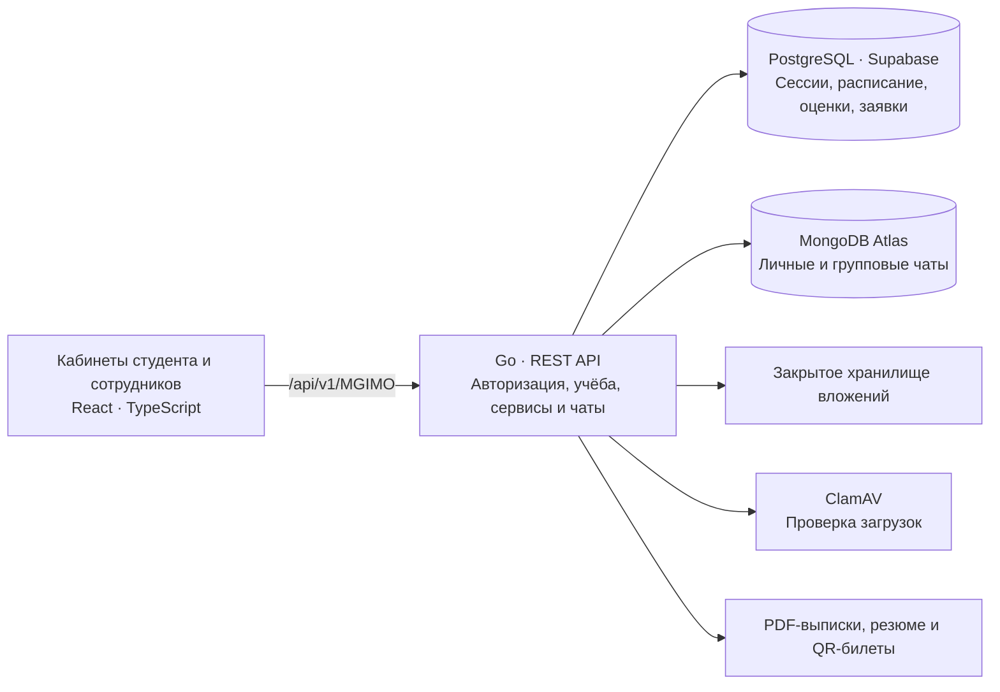

<h1 align="center">Цифровой деканат будущего</h1>

<p align="center"><strong>Личный кабинет студента и рабочее пространство деканата</strong><br>Проект хакатона MGIMO</p>

<p align="center">
  
  
  
  
  
</p>

<p align="center"><a href="#демонстрация">Демонстрация</a> · <a href="#возможности">Возможности</a> · <a href="#архитектура">Архитектура</a> · <a href="#локальный-запуск">Запуск</a></p>

Студент узнаёт об изменении пары из одного канала, ищет оценку в другом, а за справкой обращается в деканат и отдельно уточняет её статус. В портале ближайшие пары, сроки и заявки собраны на экране «Сегодня». Студент может проверить аудиторию, скачать выписку и подать заявление, а сотрудник обрабатывает его в своём кабинете.

> Хакатонный прототип с вымышленными данными. Публичный адрес демо пока не опубликован.

## Демонстрация

**«Сегодня»** показывает ближайшую пару, последние заявки и учебный прогресс.



| Успеваемость | Физкультура на телефоне |
| :--- | :---: |
| Дисциплины, баллы и статусы зачёта. PDF-выписку можно скачать за выбранный год или за все годы. | Занятия выбранного дня, фильтры по виду спорта и корпусу, свободные места. |
| <a href="docs/screenshots/academic-progress.png"></a> | <a href="docs/screenshots/sport-mobile.png"></a> |

**Открыть после локального запуска:** [главная](http://localhost:5173/) · [расписание](http://localhost:5173/#schedule) · [успеваемость](http://localhost:5173/#grades) · [физкультура](http://localhost:5173/#learning-physical). Для входа нужны демонстрационные аккаунты, созданные при настройке.

## Возможности

| Раздел | Что можно сделать |
| --- | --- |
| Учёба | Смотреть расписание на день или неделю и историю изменений, переходить к онлайн-парам, открывать задания по ссылкам преподавателей, выбирать потоки дисциплин, смотреть оценки и скачивать PDF-выписку. |
| Заявки и поддержка | Запросить справку или материальную помощь, приложить файл, следить за историей статусов, написать в деканат напрямую, найти ответ в базе знаний или запросить очную консультацию. |
| Связь | Читать новости и уведомления, общаться в личных и групповых чатах, находить активные аккаунты по уникальному номеру и видеть непрочитанные сообщения. |
| Физкультура и активности | Записаться максимум на два спортивных занятия в неделю, видеть подтверждённые преподавателем посещения, записываться на события кампуса и скачивать QR-билет в PDF. |
| Кампус и сервисы | Найти корпус или аудиторию, открыть маршрут в картах, посмотреть льготы и каталог бюро находок, забронировать переговорную, технику или место для печати. |
| Карьера и портфолио | Найти вакансии и стажировки, открыть ссылку работодателя, с третьего курса загрузить отчёт по назначенной практике, собрать PDF-резюме и поделиться отзывной ссылкой. |
| Профиль | Смотреть данные студента и номер зачётной книжки, загружать аватар, открывать QR-визитку, менять пароль и завершать другие сеансы. |

Платёжные операции представлены демонстрационными данными. QR-визитка используется для отображения данных профиля, а QR-билет — для регистрации посещения мероприятия. Дедлайны открывают внешнюю учебную платформу, где ведутся статусы сдачи. Форма для абитуриентов пока недоступна.

## Роли

| Роль | Рабочие сценарии |
| --- | --- |
| **Студент** | Свои учебные данные, документы, заявки, записи на физкультуру и события, профиль и переписка. |
| **Преподаватель** | Расписание, группы и студенты своих дисциплин, выставление баллов, публикация материалов и ссылок для сдачи заданий. Подтверждение посещений физкультуры и проверка билетов на назначенных мероприятиях. |
| **Деканат** | Контингент, задолженности и отчёт по физкультуре в пределах своих факультетов. Учебные потоки, расписание спорта, новости, льготы, мероприятия, карьерные предложения и назначения практики. |
| **Поддержка** | Очередь заявок и обращения студентов, база знаний, каталог находок, публикация слотов бронирования и ручное подтверждение посещений мероприятий. |
| **Администратор** | Аккаунты и совместимые роли, справочники корпусов и аудиторий, журнал изменений учётных записей. |

## Архитектура

React-клиент обращается к модульному монолиту на Go по REST API. PostgreSQL хранит учебные и административные данные, MongoDB — переписку, а вложения хранятся в закрытом серверном каталоге.



| Слой | Технологии |
| --- | --- |
| Интерфейс | React, TypeScript, Vite, CSS |
| Сервер | Go, `net/http`, драйверы `pgx` и MongoDB, OpenAPI |
| Данные | PostgreSQL с SQL-миграциями, MongoDB, DBML для описания реляционной схемы |
| Документы и QR | `gopdf`, `go-qrcode`, `jsQR`, ClamAV для проверки загружаемых файлов |

В разработке Vite проксирует запросы API на Go-сервер. Для публичного размещения интерфейс и API рассчитаны на один источник с HTTPS. Сборку из `dist/` раздаёт веб-сервер, который перенаправляет `/api/v1/MGIMO` на Go.

### Безопасность

- **Вход и сессии.** Пароли хешируются с Argon2id. Краткоживущий JWT используется для доступа, токен обновления ротируется и передаётся в cookie с `HttpOnly` и `SameSite=Strict`. В публичном окружении включается `Secure`.
- **Изоляция данных.** Сервер проверяет роль и доступ к конкретной записи. Участие в чате проверяется отдельно. В PostgreSQL действует RLS, а запросы к базе параметризованы.
- **Защита файлов.** API проверяет размер и тип вложений и сканирует их ClamAV до сохранения. Для получения файла проверяются полномочия пользователя.
- **Конфигурация.** Ключ подписи и строки подключения передаются через серверное окружение. Пароли и паспортные поля в ответах API отсутствуют.

## Использование ИИ

Codex использовался при разработке и проверке проекта: для чтения требований и контрактов, реализации серверных сценариев, подключения существующего интерфейса к API и разбора ошибок по результатам тестов. Команда определяла продуктовые сценарии, согласовывала изменения схемы и интерфейса и принимала результат по разделам. В работающем портале правила доступа, оценки и статусы рассчитываются обычной серверной логикой.

## Локальный запуск

Понадобятся Node.js 22.12 или новее, Go 1.27.4 или новее, отдельные PostgreSQL и MongoDB. Для загрузки вложений нужен ClamAV с базой сигнатур.

**1. Подготовьте окружение.** Создайте `backend/.env` по образцу [backend/.env.example](backend/.env.example). Задайте `DATABASE_URL`, `MONGODB_URI`, `JWT_SECRET` и `APP_ORIGIN=http://localhost:5173`. Файл с настройками хранится локально.

**2. Примените миграции, создайте демоданные и запустите API** из корня репозитория. Команды рассчитаны на Bash или Zsh. При вводе укажите собственный пароль для демонстрационных аккаунтов длиной от 12 символов.

```sh
cd backend
set -a
source .env
set +a
go run ./cmd/manage migrate
export ALLOW_DEMO_SEED=true
read -rs DEMO_PASSWORD
export DEMO_PASSWORD
go run ./cmd/manage seed
unset ALLOW_DEMO_SEED DEMO_PASSWORD
go run ./cmd/server
```

**3. Запустите интерфейс** во втором терминале из корня репозитория.

```sh
npm ci
npm run dev
```

Откройте [http://localhost:5173](http://localhost:5173/). Список демонстрационных аккаунтов и настройка вложений описаны в [инструкции серверной части](backend/README.md). Для облачных баз есть [отдельная инструкция](docs/cloud-setup.md).

## Тестирование

```sh
npm run test:frontend
npm run test:backend
npm run lint
npm run build
```

Клиентские проверки охватывают авторизацию, обновление сессии, отправку вложений и обработку ответов API. Серверные проверки охватывают правила ролей и бизнес-логику. Интеграционные сценарии с PostgreSQL и MongoDB запускаются на изолированной тестовой базе по [инструкции](backend/README.md#проверки).

## Команда

В истории коммитов проекта указаны **Vopeitno** и **Романенко Евгений**.

## Документация

[Требования](docs/requirements.md) · [Связи и архитектура](docs/architecture.md) · [Основной OpenAPI](docs/openapi.yaml) · [OpenAPI чатов](docs/messages-openapi.yaml) · [Схема DBML](docs/database.dbml) · [SQL-миграции](backend/migrations/) · [Критерии приёмки](docs/acceptance.md)
