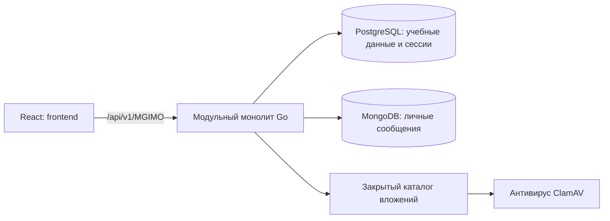

# Архитектура цифрового деканата

Состояние локальной реализации: 18.11.2026. Основание — `requirements.md`, `database.dbml`, `openapi.yaml`, `AGENTS.md` и согласования владельца в этой сессии.

Актуальное состояние 19.11.2026: Supabase Oregon (us-west-2) и MongoDB Atlas N. Virginia (us-east-1) подключены; схема и первоначальные данные подготовлены. По отдельному согласованию «Сегодня» принят владельцем; затем подключена «Успеваемость» и исправлен перенос быстрых кнопок. Оба экрана используют API в исходной структуре. «Успеваемость» открыта командой Chrome и ожидает отзыва владельца. См. `frontend-grades-review.md`; остальные экраны не перерабатывались.

## Компоненты

Go объединяет авторизацию, расписание, успеваемость, обращения, справочники, новости, спорт и сообщения. Это один процесс с отдельными модулями, как требует монолитная архитектура. Сбой MongoDB возвращает 503 только для сообщений; реляционные функции продолжают работать. Если MongoDB недоступна при старте, после её восстановления требуется перезапуск сервера. PostgreSQL проверяется при старте и через `/health/ready`.

В разработке Vite перенаправляет API на `localhost:8080`. Публичное размещение предполагает один источник для страницы и API с HTTPS. Выбор хостинга отложен владельцем. Облачные проекты созданы владельцем; API работает локально с облачными подключениями. Supabase используется как PostgreSQL, без замены согласованной авторизации на Supabase Auth. Строка подключения, MongoDB URI и ключ JWT доступны только Go-процессу.

## Связи сущностей

| Область | Сущности и связи |
| --- | --- |
| Вход | `accounts` связан ровно с одним `students`, `teachers` или `employers`. Роль совместима с типом человека. `user_sessions` принадлежит аккаунту. |
| Учебная структура | `deaneries → faculties → direction`; студент ссылается на факультет, направление и `groups`. `deanery_staff` определяет обслуживаемые сотрудником деканаты. |
| Курсы | Курс принадлежит факультету. `courseGroup` задаёт группы курса и учебный период; `courseTeacher` — преподавателей. `facultyTeacher` — преподавателей факультета. |
| Расписание | `lessons` связывает курс, группу, преподавателя и аудиторию. `classroom → buildings`; `lesson_changes` хранит старые/новые значения и автора изменения. |
| Успеваемость | `courseScore` — одна запись на курс и студента, с преподавателем и баллом. `credit` вычисляется как `score >= 60`; отсутствие результата сохраняется отдельно. `deadlines` связан с курсом. |
| Экзамены | `exams` связывает курс, группу, преподавателя и аудиторию; `exam_results` уникален по экзамену и студенту. |
| Обращения | `appointment` имеет ровно одного автора и необязательного исполнителя. Тип — `appointment_types`, хронология — `appointment_history`, передачи — `appointment_assignments`. `appointment_drafts` сохраняет незавершённые формы. |
| Уведомления | Ровно один получатель: студент, преподаватель либо сотрудник. Не более одной цели: занятие, обращение, курс, экзамен, спорт либо новость. |
| Спорт | `sports → sport_registrations`, уникальная пара занятие–студент. Отмена меняет статус, сохраняя запись. |
| Организация | `director → departament → employers`; `news` может ссылаться на деканат и автора-сотрудника. |

Имена таблиц/колонок и исходные написания `appoinmentID`, `proccess`, `departament`, `passportCodeDivison` сохранены. 33 таблицы, 252 колонки и 74 внешних ключа перенесены в начальную миграцию. Индексы внешних ключей и правила удаления описаны в `backend/migrations/README.md`.

## Авторизация и права

Access JWT действует 15 минут, refresh JWT — 7 суток. Refresh находится в HttpOnly cookie с SameSite=Strict; в публичном окружении обязателен Secure. База хранит только SHA-256 хеш случайного подписанного refresh JWT. Ротация блокирует строку сессии; повтор старого токена отвергается. Каждый защищённый запрос заново читает действительность сессии, активность аккаунта и текущую роль из PostgreSQL. Выход сразу делает выданные access JWT недействительными.

Пароли — Argon2id: случайная соль, 64 МиБ памяти, 3 прохода, 2 потока. Одновременно выполняется не более двух операций Argon2 на процесс. Старые `studentPassword`/`teacherPassword` не используются для входа; демонстрационный набор заполняет их отдельным неиспользуемым случайным хешем. Паспортные поля хешируются и никогда не возвращаются API.

Ограничения `x-roles` применяются централизованно; принадлежность объекта дополнительно проверяется в SQL и обработчиках. ADMIN не наследует права остальных ролей автоматически. Студент видит свои записи, преподаватель — свои дисциплины и обучаемых студентов, деканат — подконтрольный факультет, поддержка — очередь и назначенные ей обращения. Привилегированные ключи и паспортные хеши не попадают в интерфейс.

SQL использует параметры. Названия колонок и сортировки строятся только из серверных списков. Фрагмент SQL, введённый в текст обращения, остаётся текстом. Обещание распознать абсолютно все SQL-инъекции по строковому шаблону не даётся: защита обеспечивается отсутствием исполнения пользовательского текста как SQL.

## Транзакционные операции

- Взятие/передача обращения блокирует аккаунты специалистов в постоянном порядке, проверяет активность и занятость, затем меняет обращение и записывает истории. Один специалист не получает два активных обращения при конкурентных запросах.
- Смена статуса допускает `creating → proccess/canceled`, `proccess → ready/canceled`. Отказ требует причины. Изменение, история и уведомление выполняются в одной транзакции.
- Отправка черновика блокирует строку, создаёт обращение и историю, переводит черновик в `submitted`. Повтор — 409.
- Спортивная запись/отмена сначала блокирует родительское мероприятие. Подсчёт мест после блокировки предотвращает переполнение.
- Перенос занятия обновляет занятие, сохраняет историю и создаёт уведомления в одной транзакции.
- Изменение роли/отключение аккаунта отзывает сессии в той же транзакции.

## MongoDB

Дополнительный согласованный контракт — `messages-openapi.yaml`. Коллекции: `message_conversations` и `private_messages`. У личного диалога ровно два активных аккаунта PostgreSQL. Идентификатор диалога детерминирован по отсортированной паре UUID; индекс `_id` исключает дубликаты. Состав участников проверяется перед чтением и записью. Для списков и отметки прочтения созданы индексы; пагинация ограничена.

Между PostgreSQL и MongoDB нет общего внешнего ключа или общей транзакции. Отключённый аккаунт теряет доступ через проверку PostgreSQL; сообщения сохраняются как история. Удаление аккаунтов не опубликовано в API. Удалять аккаунты вручную с ожиданием автоматического удаления переписки нельзя.

Запись сообщения и обновление даты диалога выполняются отдельно. При сбое второй записи сообщение может сохраниться, хотя клиент получит 503. Повторная отправка в этом случае может создать дубликат; идемпотентность сообщений пока не предусмотрена контрактом. Это ограничение зафиксировано, а не скрыто успешным ответом.

## Вложения

Файлы доступны только через авторизованные маршруты. До 10 МиБ; PDF, PNG, JPEG, DOCX. Проверяются расширение, сигнатура, фактический тип и структура изображения/архива. Имя клиента не используется как путь. Антивирус должен завершиться успешно; без ClamAV загрузка возвращает ошибку и файл удаляется. Каталог закрыт правами 0700, файлы — 0600; в браузере только скачивание с `Content-Disposition: attachment`.

Диск должен быть постоянным томом выбранного хостинга. Старые вложения при замене пока сохраняются, поскольку отправленный черновик может разделять файл с обращением; перед публичным запуском нужен регламент очистки неиспользуемых файлов. Проверки формата не заменяют антивирус и не гарантируют абсолютную безопасность любого документа.

## Согласованные изменения и границы

18.11.2026 владелец подтвердил расширение всех `passport*` до `varchar(256)` под Argon2id, создание заявок студентами/преподавателями/деканатом, обработку назначенных обращений поддержкой и факультетные границы деканата. DBML и встроенная схема требований обновлены. Также согласованы личные диалоги MongoDB и отдельный контракт для них.

Форма абитуриента, выдача учётных данных по почте, восстановление пароля, изменение анкеты, аватары, учебные материалы и дополнительные бытовые сервисы интерфейса не имеют полных контрактов и не объявляются реализованными. Связь курса с группой/преподавателем задаётся исходными данными: маршрутов управления этими связями в основном OpenAPI нет. Бесплатные облачные планы не обеспечивают автоматически отказоустойчивость Go-процесса; репликация приложения и инфраструктура ещё не настроены.
